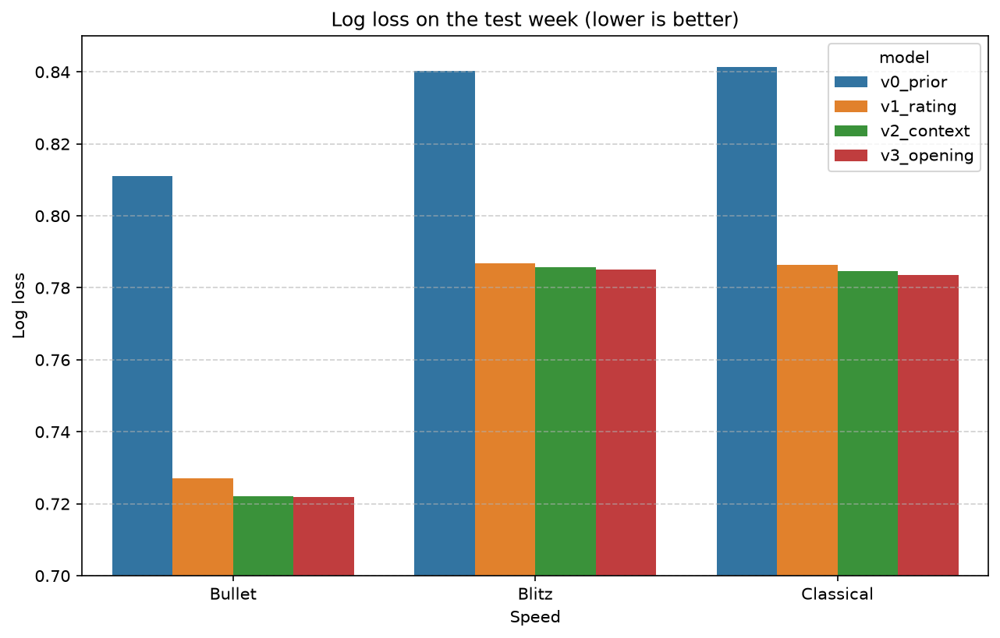

# lichess-beyond-rating

What predicts chess game outcomes beyond player ratings? Analysis and ML on 10.6M Lichess games (January 2017).

## Key findings

- The rating difference carries almost all predictable information about the result. On the test week, ratings alone improve log loss by 7.4% over a no-information baseline; the pre-game context (time control, tournament, provisional ratings) adds only 0.30%, and the opening another 0.08%.
- The models are well calibrated: a predicted 70% chance of a White win means White wins about 70% of such games.
- Time pressure matters a lot, but for how games end, not who wins: 54% of Bullet games are lost on time, vs 28% in Blitz and 16% in Classical.

## Data

- Source: [Lichess open database](https://database.lichess.org/), standard rated games, January 2017 (`.pgn.zst`, 1.9 GB compressed).
- 10,680,708 games parsed - 10,574,249 after cleaning.
- Removed: games without a result, abandoned, unterminated, ended by rules infraction, and correspondence games.

## Project structure

```
src/
  parse.py # streams .pgn.zst into Parquet (Written by AI model)
  data_prep.py # cleaning pipeline - data/clean.parquet (Written with AI model help)
  features.py # features, targets and time-based train/valid/test split
notebooks/
  00_cleaning.ipynb # data quality checks and cleaning
  01_eda.ipynb # overview before modelling
  02_result_model.ipynb # result prediction, model versions v0–v3
```

## Result model

- Target - game result. 
- Time-based split: train 31 Dec – 17 Jan, validation 18–24, test 25–31.

Model versions, each adding information to the previous one:
- **v0** – class frequencies only - baseline
- **v1** – rating difference and average rating - logistic regression
- **v2** – + time control, speed, tournament, provisional-rating flags - LightGBM + Random Forest as a comparison
- **v3** – + opening ECO code - LightGBM



- Test log loss: 0.8327 (v0) -> 0.7707 (v1) -> 0.7684 (v2) -> 0.7678 (v3).
- Same model ranking on validation and test, overall and in every speed.
- In the final model the rating difference accounts for 91.9% of LightGBM's gain, ECO 4.1%.
- Ratings help most in Bullet, where opponents are paired with the widest rating range.
- Draws are never the most likely outcome, so accuracy is capped. Log loss is the main metric.

## Limitations

- One month of data from 2017. Player playstyle, behaviour and Lichess rules may differ today.
- In this 2017 export, time controls such as 10+0 and 8+0 are labelled Classical not Rapid, so `base_time` and `increment` are used as features alongside the label.
- ECO is determined by the first moves, so v3 predicts the result after the opening, not strictly before the game.
- Validation was used for early stopping and model choice, so the reported numbers come from the untouched test week.

## Next steps

- Predicting whether a game ends on time.

## Reproduce

Python 3.12.

```bash
pip install -r requirements.txt
# download lichess_db_standard_rated_2017-01.pgn.zst into data/
python src/parse.py
python src/data_prep.py
# then run the notebooks in numerical order
```